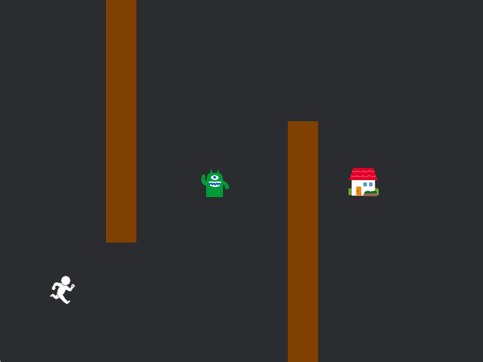

# はじめに

## この資料について

この資料はGammaのBevy初心者向けBevy入門ガイドです。 
「Bevyなんか一回も触ったことない」という初心者でも安心してBevyを始められるよう、基本的なところからUnityの使い方を解説し、簡単なゲームを作れるところまでリードしていきます。(Bevy公式ドキュメント[https://bevy.org/](https://bevy.org/))(Rust公式日本語ドキュメント[https://doc.rust-jp.rs/book-ja/](https://doc.rust-jp.rs/book-ja/))

 

↑こんな感じの帰宅ゲームを作っていきます！

まずは自分のパソコンの中にBevyの作品を入れるフォルダを作成し、そこに光の資料のGoogleドライブにあるzipファイル([Googleドライブのリンク](https://drive.google.com/file/d/1zEmmQrk4eyKeuo6VXnuEuRfCHgHhkZt4/view))を展開します。 
エクスプローラーを開き、PC＞ローカルディスク（C:）の中に「BevyWorks」フォルダを作成しましょう。（慣れている方はお好みでどうぞ。） 
光の資料のドライブにある「bevy_sample_game.zip」を右クリック、「すべて展開」を選択し、参照ボタンから先ほど作成した「BevyWorks」フォルダを選択して.zipファイルを展開します。 
