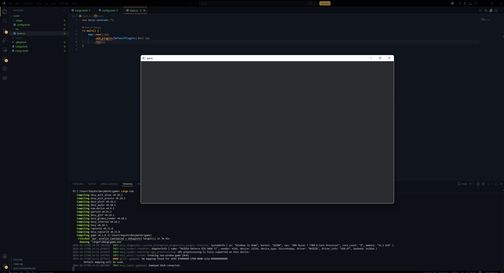

# ゲーム画面を表示する

現在の状態で`cargo run`でビルド&実行しても標準出力(ターミナル)に`Hello, world!`と表示されるだけで、ゲーム画面は表示されません。<br>
ゲーム画面を表示するためには、Bevyの`App`に`DefaultPlugins`を追加する必要があります。<br>
`src/main.rs`を開き、以下のように書き換えます。
```rust
#![cfg_attr(not(debug_assertions), windows_subsystem = "windows")] // リリースビルドではコンソールを非表示にする
use bevy::prelude::*; // Bevyの基本機能一式(Unityでのusing UnityEngine;に相当する)

// エントリーポイント
fn main() {
    App::new() // Bevyアプリケーションを作成
        .add_plugins(DefaultPlugins) // デフォルトプラグインを追加。これでウィンドウが表示されるようになる
        .run(); // アプリの起動
}
```

<br>

これでゲームのウィンドウが立ち上がるようになりました。<br>
このページのこれから先は、ウィンドウの大きさやフルスクリーンにするかなどの設定ファイルを作成して、それを読み込むことで、ゲームのウィンドウの設定を変更していきます。少しめんどくさいので、最初はこのままでも構いません。<br>

## ウィンドウのサイズ等についての設定ファイルを作成する

まず、プロジェクトディレクトリ直下に`settings/settings.toml`というファイルを作成します。<br>
中は以下のような形式で書きます
```toml
[window]
width = 800
height = 600
title = "Game"
fullscreen = false
vsync = true
```

## 設定ファイルをビルド時に実行ファイルと同じディレクトリにコピーする

次に、`build.rs`というファイルをプロジェクトディレクトリ直下に作成し、以下のように書きます。`build.rs`は、Cargoがビルドする際に自動的に実行されるスクリプトです。ここでは、`settings/settings.toml`をビルド時に実行ファイルと同じディレクトリにコピーする処理を行います。
```rust
use std::fs;
use std::path::Path;

fn main() {
    // 実行ファイルの出力先ディレクトリを取得
    let out_dir = std::env::var("OUT_DIR").unwrap();

    // target/debug or target/releaseに辿る
    let target_dir = Path::new(&out_dir).ancestors().nth(3).unwrap();

    // コピー先のパス
    let dest = target_dir.join("settings/");
    // コピー元のパス
    let src = Path::new("settings/");

    // 既存削除
    if dest.exists() {
        fs::remove_dir_all(&dest).unwrap();
    }

    // コピー
    copy_dir_all(src, &dest).unwrap();
}

// 再帰コピー
fn copy_dir_all(src: impl AsRef<Path>, dst: impl AsRef<Path>) -> std::io::Result<()> {
    fs::create_dir_all(&dst)?;

    for entry in fs::read_dir(src)? {
        let entry = entry?;
        let ty = entry.file_type()?;

        if ty.is_dir() {
            copy_dir_all(entry.path(), dst.as_ref().join(entry.file_name()))?;
        } else {
            fs::copy(entry.path(), dst.as_ref().join(entry.file_name()))?;
        }
    }

    Ok(())
}
```

## 設定ファイルを読み込む

`src/settings.rs`というファイルを作って以下のように書きます。ここでは、設定の構造体の定義と、設定ファイルを読み込む関数を定義しています。<br>
```rust
use bevy::prelude::*;
use serde::{Deserialize, Serialize};

// 設定を表す構造体
#[derive(Resource, Debug, Clone, Deserialize, Serialize)]
pub struct Settings {
    pub window: WindowSettings,
}

// ウィンドウ設定を表す構造体
#[derive(Debug, Clone, Deserialize, Serialize)]
pub struct WindowSettings {
    pub width: u32,
    pub height: u32,
    pub title: String,
    pub fullscreen: bool,
    pub vsync: bool,
}

// デフォルトの設定を提供するための実装
impl Default for Settings {
    fn default() -> Self {
        Self {
            window: WindowSettings {
                width: 800,
                height: 600,
                title: "Game".to_string(),
                fullscreen: false,
                vsync: true,
            },
        }
    }
}

use std::fs;

use anyhow::Error;

// 設定をロードする関数
fn load_settings() -> Result<Settings, Error> {
    let settings_str = fs::read_to_string("settings/settings.toml")?;
    let settings: Settings = toml::from_str(&settings_str)?;
    Ok(settings)
}

// 設定を取得する関数。ロードに失敗した場合はデフォルト設定を返す。
pub fn get_settings() -> Settings {
    match load_settings() {
        Ok(settings) => settings,
        Err(err) => {
            eprintln!("Failed to load settings: {err}");
            Settings::default()
        }
    }
}
```

また、`src/main.rs`を以下のように書き換えます。
```rust
#![cfg_attr(not(debug_assertions), windows_subsystem = "windows")] // リリースビルドではコンソールを非表示にする

use bevy::{prelude::*, window::WindowResolution};
mod settings; // 設定のモジュールをインポート


fn main() {
    // settings/settings.tomlから設定を読み込む
    let settings = settings::get_settings();
    // Bevyアプリケーションを作成
    let mut app = App::new();
    // デフォルトプラグインを追加し、ウィンドウ設定を上書きする
    app.add_plugins(DefaultPlugins.set(WindowPlugin {
        primary_window: Some(Window {
            title: settings.window.title.clone(),
            resolution: WindowResolution::new(settings.window.width, settings.window.height),
            mode: if settings.window.fullscreen {
                bevy::window::WindowMode::BorderlessFullscreen(MonitorSelection::Primary)
            } else {
                bevy::window::WindowMode::Windowed
            },
            present_mode: if settings.window.vsync {
                bevy::window::PresentMode::AutoVsync
            } else {
                bevy::window::PresentMode::AutoNoVsync
            },
            ..default()
        }),
        ..default()
    }));
    // 設定をリソースとしてアプリに挿入
    app.insert_resource(settings);
    // アプリの起動
    app.run();
}
```

これで`settings/settings.toml`の内容に応じて、ゲームのウィンドウのサイズやタイトル、フルスクリーンモード、VSyncの有効/無効を設定できるようになりました。<br>
適当に数値を変えて、`cargo run`でビルド&実行してみましょう。

次はいよいよゲームの中身を作っていきます。
